# Data model

Two parts: what exists **today** (JSON files, file schema versions 1 and 2), and the **target** (content model v2 plus
the database). The TypeScript types in `src/types.ts` are the contract for today's files. Reasons are in `decisions.md`,
entries 4, 8, 15, 16, 18, 22–23, 30, 42, 43, 44, 46, 47 and 48.

"v2" names two different things, so keep them apart:

- **File schema version**: the `schemaVersion` field in each JSON file, checked by `npm run data`. Story documents are at
  `2` today (decision 46). This is shipped.
- **Content model v2**: the target in this document. Stories and sources split into their own files, and claims and moments
  extracted into tables on publish (decision 22). Not built, and no file carries its number yet.

## Today (JSON files, file schema versions 1 and 2)

Story documents are at `schemaVersion: 2` (decision 46). Every fact carries an explicit `claim` (decision 44), and
`npm run data` rejects a story at version 1 rather than upgrading it. The other files stay at `schemaVersion: 1`, because
their contracts did not change.

| File | schemaVersion | Holds |
|---|---|---|
| `public/data/site.json` | 1 | Site name, motto, `mediaBaseUrl`, `defaultPaper`, list of papers `{slug, title, dataUrl}` |
| `public/data/tags.json` | 1 | Tag vocabulary: facets, tags `{id: "facet/slug", facet, label, parent, aliases}` |
| `public/data/library.json` | 1 | The editorial layer (decision 29): `fields`, `volumes`, `stories`, `front`, `issues`, `companies`, `storylines`, and the idea graph `nodes` and `relations`. |
| `public/data/papers/<slug>.json` | 2 | One story document (`StoryDoc` in `src/types.ts`): `schemaVersion`, `slug`, `pageTitle`, `summary`, `desk`, `tags[]`, `blocks[]`, optional `cover` and `hook`, and its source. A paper story has `paper` (`PaperSource`); a company post has `kind: "blog"` and `blog` (`BlogSource`, with `trust: "company_reported"`). No issue and none of our dates (decision 31). |
| `public/data/search-index.json` | 1 | Generated by `npm run data`: per paper its cover, moments and approved tags |

Blocks are a discriminated union: `lead`, `story`, `comic`, `facts`. Each media entry is
`{type, src, width?, height?, alt?, poster?}`.

**Claims and trust today.** Each fact has a required `claim` (`illustration`, `model_design` or `measured_result`;
decisions 18 and 44). A strip or chapter keeps one `provenance` stamp (decision 47). Trust is not on `PaperSource`: a paper's
trust is the `trust` of its `library.json` story entry, and a company post's is `BlogSource.trust`. `scripts/build-index.ts`
copies it onto each moment (decision 43), and `claimLabel()` in `src/lib/claimLabel.ts` renders every label.

**Relations today.** Each `library.json` `relations[]` entry is `{from, to, kind, note}`, with optional `cited` and
`crossField`. `kind` is `builds_on`, `improves_on` or `uses_method` (the diagram below uses a wider set of names). Direction:
`from` is the earlier idea, and `to` is the later work that builds on it, improves it or uses its method. For example,
`transformer → bert` with `uses_method` reads "BERT uses the method of the Transformer", and `familyOf()` in
`src/lib/library.ts` and `FamilyTree.tsx` read it the same way. `npm run data` checks only that both ends are known nodes. It
does not check kind, direction or evidence.

## Runtime read path (decision 48)

The first runtime read is a slice of the target below: two Supabase tables, one publish function, and a public read
contract. Everything else stays in files (see `docs/STATE.md`, "Runtime data").

- `story`: `id`, `slug` (unique, the public key), `kind` (`paper` | `blog`), `live_version_id`. Anon may read it.
- `published_version`: `id`, `story_id`, `story_slug` (denormalized so public reads need no join), `schema_version`,
  `status` (`staging` | `live` | `retired`), `document` (jsonb, the `PaperDoc`), `library_entry` (jsonb, the `LibraryStory`),
  `created_at`. Anon may read only rows where `status = 'live'`. A partial unique index allows one live row per story.
- `publish_version(version_id)`: a security-definer SQL function that retires the live row, makes the new row live, and
  moves `story.live_version_id`, all in one transaction. Granted to `service_role` only, so the publish CLI is its only caller.
- Public read contract: readers use the publishable key only. One read returns the live `document` and `library_entry`
  for a slug. A second returns every live `story_slug` and `library_entry` pair for the home-page overlay.
- No foreign key constraints (decisions 30 and 38). `story_id` is indexed and joined in code.

The content model is unchanged. `document` is the file-backed `PaperDoc` (`schemaVersion: 2`, `src/types.ts`) and remains
the authoritative shape; the JSON files stay the source, and each published version stores a copy. The derived tables in
the diagram below (Moment, Fact, Source and the rest) are not built by this slice.

## Target

### Principles

1. **A published story is one typed, versioned document** (`PublishedVersion.document`), validated against the
   TypeScript block union. Authors and the AI converter produce this document. Don't break it into generic block rows.
2. **Anything we query, reuse or show outside the story gets extracted into its own table:** moments, facts, tags,
   media, sources and relations. Extraction runs on publish, and each extracted row points back to its location in the
   document (`blockPath`).
3. **Every claim has a kind and every source has a trust level** (decisions 18, 43 and 44):
   - `claimKind`: `illustration` | `model_design` | `measured_result`
   - `trust`: `peer_reviewed` | `preprint` | `company_reported` | `journal_published`

   The UI renders these as fixed labels: "Illustration · numbers invented", "From the paper · model design",
   "Measured result · peer-reviewed", and the journal-publication label. Trust describes the source and the claim kind describes the assertion. A sourced claim
   carries both. An illustration carries neither (decision 44).
4. **Keys and references** (decision 30):
   - Every table has `id bigint generated always as identity`, the Postgres auto-increment key. It is the only thing
     other tables use to point at a row, always as a `<thing>_id bigint` column (`story_id`, `source_id`, `tag_id` …).
   - **No foreign key constraints (decisions 30 and 38).** Rows are related by joining on the `_id` columns. They are indexed
     but declared without `REFERENCES`. Integrity is kept by
     the import validator (`npm run data` today), the application code, and a scheduled orphan-check query. Rows are
     retired with a `status`, not deleted, so references don't dangle.
   - Our human-readable keys live under their own column names, never in `id`: `Story.slug` (unique, used in URLs as
     `/papers/<slug>`), `Moment.key`, `Tag.key` (`facet/slug`), `Facet.key`, plus external ids such as
     `Source.arxivId` and `Source.doi`.
   - In the diagram below, an arrow means "this column holds the other row's `id`". It is a logical link, not a
     database constraint.

### Schema (Postgres on Supabase)

In the diagram, an arrow points from a record to the record it refers to.

```mermaid
classDiagram
  direction LR

  class Volume { number; title; kind: regular|special; month }
  class Issue { volume→Volume; number; title; theme; cover→MediaAsset; publishedAt; status }
  class IssueStory { issue→Issue; story→Story; position; role: lead|feature|brief|vault|real_world; presentation: full|brief|snack }

  class Story { slug (unique, public key); pageTitle; summary; readingLevel; status: draft|review|scheduled|published; publishedAt; cover→MediaAsset; liveVersion→PublishedVersion }
  class PublishedVersion { story→Story; version; schemaVersion; document: typed JSON; contentHash; publishedAt; status: staging|live|retired }
  class Moment { key (stable, unique per story); story→Story; version→PublishedVersion; blockPath; kind: strip|chapter|fact|slide; presentation: card|snack; position; claimKind; status; media→MediaAsset; fact→Fact }

  class Source { type: paper|blog|talk|rfc|patent; title; url; year; venue; trust: peer_reviewed|preprint|company_reported|journal_published; doi; arxivId; openalexId; s2Id; organization→Organization }
  class SourceSnapshot { source→Source; versionLabel; retrievedAt; archivedUrl; contentHash; status: live|updated|removed }
  class StorySource { story→Story; source→Source; role: primary|supporting }
  class Author { name; orcid }
  class SourceAuthor { source→Source; author→Author; position; affiliation→Organization }
  class Organization { name; kind: company|university|lab|government }
  class Feed { organization→Organization; rssUrl; lastCheckedAt }
  class FeedEntry { feed→Feed; url; title; seenAt; state: discovered|queued|approved|dismissed|imported; source→Source }

  class Relation { from→Source; to→Source; type: builds_on|improves|uses_method|puts_into_practice|disagrees|same_problem; strength; basis; origin: citation_api|ai|editor; status }
  class RelationEvidence { relation→Relation; citation→Citation; quote; location; status; reviewedBy; reviewedAt }
  class Storyline { slug; title; summary }
  class StorylineStep { storyline→Storyline; source→Source; position; note }

  class Fact { source→Source; value; unit; metric; dataset; comparison; claimKind: illustration|model_design|measured_result; displayText; trust; citation→Citation; verifiedBy; verifiedAt }
  class Citation { source→Source; snapshot→SourceSnapshot; label; url; quote }
  class MediaAsset { storageKey; type: svg|image|video|lottie; mime; width; height; duration; alt; captions; poster→MediaAsset; reducedMotion→MediaAsset; rights: original|licensed|generated; credit; contentHash }

  class Facet { key; label; description }
  class Tag { key: facet/slug; facet→Facet; label; parent→Tag; aliases[] }
  class StoryTag { story→Story; tag→Tag; relevance 0–1; basis: paper|background|editorial; evidenceUrl; origin: ai|editor; status }
  class GlossaryTerm { tag→Tag; term; kidExplanation }

  Issue --> Volume
  IssueStory --> Issue
  IssueStory --> Story
  PublishedVersion --> Story
  Moment --> Story
  Moment --> PublishedVersion
  Moment --> MediaAsset
  Moment --> Fact
  SourceSnapshot --> Source
  StorySource --> Story
  StorySource --> Source
  SourceAuthor --> Source
  SourceAuthor --> Author
  SourceAuthor --> Organization
  Source --> Organization
  Feed --> Organization
  FeedEntry --> Feed
  FeedEntry --> Source
  Relation --> Source : from / to
  RelationEvidence --> Relation
  RelationEvidence --> Citation
  StorylineStep --> Storyline
  StorylineStep --> Source
  Fact --> Source
  Fact --> Citation
  Citation --> Source
  Citation --> SourceSnapshot
  Tag --> Facet
  Tag --> Tag : parent
  StoryTag --> Story
  StoryTag --> Tag
  GlossaryTerm --> Tag
```

### Notes

- **Hosting (decision 34):** Supabase. Migrations are SQL files in `supabase/migrations/`. The auto-generated REST API infers
  relationships from foreign key constraints, so without them (decision 38), nested reads use SQL views, database functions or server code.
- **Row-level security:** the story slice has it now (decision 48, see "Runtime read path" above). The wider policies,
  which show readers only approved tags and verified relations, wait for schema that doesn't exist yet: a relation `status`
  (proposed, verified, rejected) with evidence, and immutable published versions that own their derived rows. Those
  columns are prerequisites for those policies, and the policies need tests.

- **Stub sources:** a `Source` with no `StorySource` row is a greyed "not explained yet" node in the graph.
- **Two dates:** `Source.year` (original publication) vs `Story.publishedAt` and `Issue.publishedAt` (ours). Only
  `Source.year` is shown on a story. `Story.publishedAt` is internal (ordering, "new" badges in feeds); our dates are
  shown on issues and volumes only (decision 31). Stories join issues through `IssueStory`, never the reverse.
- **Moments** have stable ids, so snacks, front-page tiles, search results and share links survive re-publishing. When
  a block is removed, its moment is retired (`status`), not deleted.
- **Facts** are structured (`value`, `unit`, `metric`, `dataset`, `comparison`), so "Numbers from the papers" can be
  searched and compared. `displayText` is the kid-level sentence.
- **Sources change.** Papers get new arXiv versions and blogs get edited. Citations point at the `SourceSnapshot` they
  were checked against.
- **What the site reads:** an API returns `PublishedVersion.document` in the same shape as today's JSON, so the frontend
  doesn't care whether it reads files or the database. Only the `live` version is ever read (see "Publish and import atomicity").
- **Graph queries:** recursive CTEs over `Relation` give ancestors and descendants. A graph database isn't needed until
  much larger scale.

### Seeding and backup (decision 35)

- `data/seed/**` is the Git-tracked editorial seed; `backups/media/**` is the Git-tracked recovery copy for media.
  Neither directory is served by the app. `npm run seed` loads editorial records into an empty Supabase project,
  upserting by `slug` / `key`; the media upload tool reads the backup and writes objects to Supabase Storage. Storage
  keys mirror the story media paths.
- Numeric ids are assigned by Postgres and change on every re-seed. Don't use them as external identifiers or rely on
  them across re-seeds: URLs, files, analytics and the portable seed or export use slugs and keys, and references are
  remapped on import. Database-native dumps, migration records and audit logs may keep them as internal references (decision 37).
- `npm run export` brings database-side changes (approved tags, verified relations, new issues) back into the files. It is a
  required, checked release step: it fails if it would lose a database-side change or if a record diverged in both
  places (decision 37).

### Publish and import atomicity

This is the detail behind the transactional publish that decisions 38 and 42 require. The seed (`npm run seed`) and the import
job use the same path, so a bad file cannot half-load a story.

**The unit of publish.** One `PublishedVersion` of one `Story`, plus the derived rows that belong to that version, each
carrying its `published_version_id`:

- `Moment`, `Fact`, `StoryTag` and `Citation` rows built from the version's document.
- `Relation` and `RelationEvidence` rows that the version introduces. Relations are shared graph edges, so a publish
  never rewrites a relation that is already verified or rejected.
- References to `SourceSnapshot` rows (through `Citation.snapshot_id`). A publish creates snapshots only in staging and
  never changes an existing one; snapshots are immutable once written.

Not part of the unit: `Story` (its slug and status), `Source`, `Tag`, `MediaAsset` and `Organization`. The version points
at these by key. An import may add a missing shared row inside the same transaction, but it never edits a row that is
already live.

**Staging and promotion.**

1. Write the version's derived rows with `published_version_id`, and set `PublishedVersion.status = staging`. Staging rows
   are invisible to readers and to the static build.
2. Run every check below against the staging rows. The orphan check covers the staging rows and the live rows they point to.
3. If every check passes, promote in one transaction with one `UPDATE` that sets the new version to `live` and the previous
   one to `retired`, and one `UPDATE` that moves `Story.liveVersion` to the new version. Readers read only `live` rows, so
   they see the old set or the new set, never a mix.

**Checks before promotion.** All must pass. Any failure stops the publish. Nothing is skipped or dropped silently.

- Every `_id` column in the staging rows resolves to an existing row that is not retired (`story_id`, `source_id`,
  `tag_id`, `media_id`, `fact_id`, `citation_id`, `snapshot_id`, `relation_id`).
- No duplicate `Moment.key` within the version.
- Every media reference (`media_id`, `poster_id`, `reduced_motion_id`) resolves to a `MediaAsset`, and its file exists at
  `storageKey`.
- Every `StoryTag` points to an existing tag and has status `approved`.
- The version's `document` validates against the block union (principle 1). Every fact carries its `claimKind`, and every
  sourced fact and source carries `trust`. Illustrations carry no trust (decisions 18 and 44).

**Remapping by key, never by numeric id.** Files carry keys, not numeric ids (decisions 35 and 37). The importer resolves
each reference by its key inside the same transaction: a story by `slug`, a moment by `key` within the version, a tag by
`key` (`facet/slug`), a source by its key in `sources/`, and media by `storageKey`. It then writes the matching `<thing>_id`.
A key that does not resolve fails the import, and nothing is partly written. The export reverses the mapping (`id` to key).
Round-trip tests prove that every reference remaps (decision 38).

**On failure.**

- Staging, every check, and the promotion `UPDATE`s run inside one uncommitted transaction. A failed check, or any error inside
  it, rolls the transaction back; the staging rows were never committed, so nothing needs to be cleaned up. (If a future
  migration ever commits staging first — for example, to allow a human review step between staging and promotion — the failure
  path needs an explicit `DELETE WHERE published_version_id = …` and this section is updated.)
- The previous `PublishedVersion` stays `live`, and `Story.liveVersion` does not move. Readers and the static pages keep
  the old version.
- The promotion `UPDATE` is conditional: it moves the story only if `liveVersion` is still the version the import started
  from. If another publish got there first, this one fails and must be re-run against the new live version.
- The owner gets a reconciliation diff, written to the import report and never applied on its own. For each derived type it
  lists the rows added, removed and changed (by key) between the live version and the proposed one, plus each failed check
  with the keys involved. A person decides what to do with it (decision 37).

### Splitting the story files (target content model v2, JSON first)

This is the target content model v2. It is **not** the file schema version 2 that story documents already use (decision 46).
Nothing below is built yet.

- `papers/<slug>.json` becomes `stories/<slug>.json` (the typed document) plus `sources/<id>.json`. The file name is the
  future `Story.slug`; the numeric `id` doesn't exist in files and is assigned by Postgres when the story is imported.
- Claims: facts already carry `claim` (decision 44). Strips and chapters still carry one `provenance` stamp (decision 47),
  with values `illustration | evidence | model_design`. Target: give strips, chapters and facts a `claimKind` and map
  `provenance` to it (`evidence` becomes `measured_result`), then review each item (e.g. "8 heads" becomes `model_design`).
- Issues live in `issues/<volume>-<number>.json` with `stories[{slug, role, presentation}]` (today: `library.json`).
- Story documents already reject schema version 1 (decision 46), so the "check both versions" step is over for stories. When
  the split lands, the validator checks the new layout and the old `papers/` path is dropped.

## V1 normalized schema (decision 49)

The Phase 3b tables, with the frozen names from `docs/handoffs/v1-schema-contract.md`. They are built by migrations
`20261106100000` (core, Agent A), `20261106100001` (editorial, Agent B) and `20261106100002` (public views, Agent D). Names
here are the contract names, and they differ from the sketch in "Target" above, which stays as the design sketch.

Rules that hold for every table (contract, "Shared conventions"): `bigint generated always as identity` keys; `slug` or `key`
as the public key; `<thing>_id bigint` references with no `REFERENCES`, each indexed; `created_at` on every table;
enumerations as `text` with a `CHECK`; RLS on and no public policy. Anon reads only through the `v_*` views.

**Core (story content, decision 49):**

- `published_version` (existing): adds the metadata columns `headline`, `accent`, `dek`, `summary`, `page_title`, `desk`,
  `authors`, `year`, `trust`, `minutes`, `role`, `note`, `source_url`, `source_archived_url`. `document` and `library_entry`
  stay; `library_entry` is transitional.
- `source`: one row per paper or blog post, keyed by `url` within a `kind`. Not read by anon yet.
- `source_snapshot`: archived (Wayback) captures of a source.
- `story_source`: which sources a version cites, and whether each is primary or secondary.
- `citation`: one row per source-link appearance in a version's document (`anchor`, `url`, `label`, `context`).
- `media_asset`: SVG, image or video files a version uses (`path` unique per version).
- `facet`, `tag`: the tag vocabulary (13 facets, about 93 tags, `aliases` as `text[]`).
- `story_tag`: tags on a version with `basis` and `status`. Only `approved` rows are public.
- `moment`: the snacks (lead, hook, chapter, strip panel, fact), each with `claim` and `trust`. Keyed by `key` per version.
- `fact`: one row per fact card item in a version, with `claim`, `figure` and `text`.

**Editorial and collections (decision 49):**

- `volume`, `issue`, `issue_story`: volumes (months), issues inside them, and the stories in each issue, in order.
- `company`, `company_post`, `company_built_on`: companies, the stories they published, and the graph nodes they claim to build on.
- `storyline`, `storyline_step`: guided paths through the graph.
- `field`: the map's fields, with their cluster coordinates.
- `node`: a graph node (a paper or a blog post), with its field and its story if we have one.
- `relation`, `relation_evidence`: typed edges between nodes, with `verified` and their evidence. Only verified, non-sample edges are public.
- `front_placement`: one row, `key = 'current'`, whose `data` jsonb matches the `library.json` `front` block (slugs, not ids).
- `story_field`: the fields a version belongs to (per version, not per story).

**Public views (decision 49).** Anon reads only these. Each one keeps only rows that are live (`published_version.status = 'live'`),
public (`sample = false`), and approved or verified where the table has that state:

- `v_live_story`: one row per live, non-sample story, with its metadata, `document` and `library_entry`. `security_invoker`.
- `v_live_library_entry`: `(story_slug, library_entry)` for each row of `v_live_story`. `security_invoker`.
- `v_live_story_by_slug(text)`: the same row for one slug. A SQL function, granted to anon.
- `v_live_moment`, `v_live_fact`, `v_live_citation`, `v_live_media_asset`, `v_live_story_tag` (approved only), `v_live_story_field`: the extracted rows
  of live versions, keyed by `story_slug`, with media and tag references resolved to their path or key.
- `v_facet`, `v_tag`: the whole vocabulary.
- `v_volume`, `v_issue`, `v_issue_story`, `v_company`, `v_company_post`, `v_company_built_on`, `v_storyline`, `v_storyline_step`,
  `v_field`, `v_node`: the editorial layer, with references resolved to slugs.
- `v_relation`, `v_relation_evidence`: verified, non-sample edges only, with both endpoints public.
- `v_front_placement`: the current front-placement row.

The two story views are `security_invoker`. The rest run with owner rights, so the WHERE clause in each view is what keeps
staging, retired and sample rows out. Anon has no grant on the raw tables.

**Still file-backed (not in the schema yet):** `site.json`, `tags.json` as the editorial seed, `search-index.json`, prerendered
HTML, media files, and the `library.json` shell for anything the views do not yet cover. The browser still reads
`published_version` directly (decision 48); it moves to the views in a later batch.
