# Data model

Two parts: what exists **today** (JSON files, schema v1), and the **target** (content model v2 plus the database).
The TypeScript types in `src/types.ts` are the contract for today's files. Reasons are in `decisions.md`, entries 4, 8,
15, 16, 18, 22–23 and 30.

## Today (JSON files, schema v1)

| File | Holds |
|---|---|
| `public/data/site.json` | Site name, motto, `mediaBaseUrl`, `defaultPaper`, list of papers `{slug, title, dataUrl}` |
| `public/data/tags.json` | Tag vocabulary: facets, tags `{id: "facet/slug", facet, label, parent, aliases}` |
| `public/data/papers/<slug>.json` | One story: `pageTitle`, `summary`, `desk`, `paper` (source metadata), `tags[]`, `blocks[]`, optional `cover` and `hook`. No issue and none of our dates (decision 31). |
| `public/data/search-index.json` | Generated by `npm run data`: per paper its cover, moments and approved tags |

Blocks are a discriminated union: `lead`, `story`, `comic`, `facts`. Each media entry is
`{type, src, width, height, alt, poster?}`.

## Target

### Principles

1. **A published story is one typed, versioned document** (`PublishedVersion.document`), validated against the
   TypeScript block union. Authors and the AI converter produce this document. Don't break it into generic block rows.
2. **Anything we query, reuse or show outside the story gets extracted into its own table:** moments, facts, tags,
   media, sources and relations. Extraction runs on publish, and each extracted row points back to its location in the
   document (`blockPath`).
3. **Every claim has a kind and every source has a trust level** (decision 18):
   - `claimKind`: `illustration` | `model_design` | `measured_result`
   - `trust`: `peer_reviewed` | `preprint` | `company_reported`

   The UI renders these as fixed labels: "Illustration · numbers invented", "From the paper · model design",
   "Measured result · peer-reviewed".
4. **Keys and references** (decision 30):
   - Every table has `id bigint generated always as identity`, the Postgres auto-increment key. It is the only thing
     other tables use to point at a row, always as a `<thing>_id bigint` column (`story_id`, `source_id`, `tag_id` …).
   - **No foreign key constraints (decisions 30 and 38).** Rows are related by joining on the `_id` columns. They are indexed
     but declared without `REFERENCES`. Integrity is kept by
     the import validator (`npm run data` today), the application code, and a scheduled orphan-check query. Rows are
     retired with a `status`, not deleted, so references don't dangle.
   - Our human-readable keys live under their own column names, never in `id`: `Story.slug` (unique, used in URLs as
     `/papers/<slug>`), `Moment.key`, `Tag.key` (`facet/slug`), `Facet.key`, plus external ids such as
     `Source.arxivId` and `Source.doi`.
   - In the diagram below, an arrow means "this column holds the other row's `id`". It is a logical link, not a
     database constraint.

### Schema (Postgres on Supabase)

In the diagram, an arrow points from a record to the record it refers to.

```mermaid
classDiagram
  direction LR

  class Volume { number; title; kind: regular|special; month }
  class Issue { volume→Volume; number; title; theme; cover→MediaAsset; publishedAt; status }
  class IssueStory { issue→Issue; story→Story; position; role: lead|feature|brief|vault|real_world; presentation: full|brief|snack }

  class Story { slug (unique, public key); pageTitle; summary; readingLevel; status: draft|review|scheduled|published; publishedAt; cover→MediaAsset; liveVersion→PublishedVersion }
  class PublishedVersion { story→Story; version; schemaVersion; document: typed JSON; contentHash; publishedAt; status: staging|live|retired }
  class Moment { key (stable, unique per story); story→Story; version→PublishedVersion; blockPath; kind: strip|chapter|fact|slide; presentation: card|snack; position; claimKind; status; media→MediaAsset; fact→Fact }

  class Source { type: paper|blog|talk|rfc|patent; title; url; year; venue; trust: peer_reviewed|preprint|company_reported; doi; arxivId; openalexId; s2Id; organization→Organization }
  class SourceSnapshot { source→Source; versionLabel; retrievedAt; archivedUrl; contentHash; status: live|updated|removed }
  class StorySource { story→Story; source→Source; role: primary|supporting }
  class Author { name; orcid }
  class SourceAuthor { source→Source; author→Author; position; affiliation→Organization }
  class Organization { name; kind: company|university|lab|government }
  class Feed { organization→Organization; rssUrl; lastCheckedAt }
  class FeedEntry { feed→Feed; url; title; seenAt; state: discovered|queued|approved|dismissed|imported; source→Source }

  class Relation { from→Source; to→Source; type: builds_on|improves|uses_method|puts_into_practice|disagrees|same_problem; strength; basis; origin: citation_api|ai|editor; status }
  class RelationEvidence { relation→Relation; citation→Citation; quote; location; status; reviewedBy; reviewedAt }
  class Storyline { slug; title; summary }
  class StorylineStep { storyline→Storyline; source→Source; position; note }

  class Fact { source→Source; value; unit; metric; dataset; comparison; claimKind: model_design|measured_result; displayText; trust; citation→Citation; verifiedBy; verifiedAt }
  class Citation { source→Source; snapshot→SourceSnapshot; label; url; quote }
  class MediaAsset { storageKey; type: svg|image|video|lottie; mime; width; height; duration; alt; captions; poster→MediaAsset; reducedMotion→MediaAsset; rights: original|licensed|generated; credit; contentHash }

  class Facet { key; label; description }
  class Tag { key: facet/slug; facet→Facet; label; parent→Tag; aliases[] }
  class StoryTag { story→Story; tag→Tag; relevance 0–1; basis: paper|background|editorial; evidenceUrl; origin: ai|editor; status }
  class GlossaryTerm { tag→Tag; term; kidExplanation }

  Issue --> Volume
  IssueStory --> Issue
  IssueStory --> Story
  PublishedVersion --> Story
  Moment --> Story
  Moment --> PublishedVersion
  Moment --> MediaAsset
  Moment --> Fact
  SourceSnapshot --> Source
  StorySource --> Story
  StorySource --> Source
  SourceAuthor --> Source
  SourceAuthor --> Author
  SourceAuthor --> Organization
  Source --> Organization
  Feed --> Organization
  FeedEntry --> Feed
  FeedEntry --> Source
  Relation --> Source : from / to
  RelationEvidence --> Relation
  RelationEvidence --> Citation
  StorylineStep --> Storyline
  StorylineStep --> Source
  Fact --> Source
  Fact --> Citation
  Citation --> Source
  Citation --> SourceSnapshot
  Tag --> Facet
  Tag --> Tag : parent
  StoryTag --> Story
  StoryTag --> Tag
  GlossaryTerm --> Tag
```

### Notes

- **Hosting (decision 34):** Supabase. Migrations are SQL files in `supabase/migrations/`. The auto-generated REST API infers
  relationships from foreign key constraints, so without them (decision 38), nested reads use SQL views, database functions or server code.
- **Row-level security** (only needed once something reads at run time, decision 36) will show readers only published stories,
  approved tags and verified relations. It depends on schema that doesn't exist yet: a relation `status`
  (proposed, verified, rejected) with evidence, and immutable published versions that own their derived rows. Those
  columns are prerequisites for the policy migration, and the policies need tests.

- **Stub sources:** a `Source` with no `StorySource` row is a greyed "not explained yet" node in the graph.
- **Two dates:** `Source.year` (original publication) vs `Story.publishedAt` and `Issue.publishedAt` (ours). Only
  `Source.year` is shown on a story. `Story.publishedAt` is internal (ordering, "new" badges in feeds); our dates are
  shown on issues and volumes only (decision 31). Stories join issues through `IssueStory`, never the reverse.
- **Moments** have stable ids, so snacks, front-page tiles, search results and share links survive re-publishing. When
  a block is removed, its moment is retired (`status`), not deleted.
- **Facts** are structured (`value`, `unit`, `metric`, `dataset`, `comparison`), so "Numbers from the papers" can be
  searched and compared. `displayText` is the kid-level sentence.
- **Sources change.** Papers get new arXiv versions and blogs get edited. Citations point at the `SourceSnapshot` they
  were checked against.
- **What the site reads:** an API returns `PublishedVersion.document` in the same shape as today's JSON, so the frontend
  doesn't care whether it reads files or the database. Only the `live` version is ever read (see "Publish and import atomicity").
- **Graph queries:** recursive CTEs over `Relation` give ancestors and descendants. A graph database isn't needed until
  much larger scale.

### Seeding and backup (decision 35)

- The files in git are the complete seed: `public/data/**` and `public/media/**`. `npm run seed` loads them into an empty
  Supabase project, upserting by `slug` / `key`. Storage keys mirror the media paths.
- Numeric ids are assigned by Postgres and change on every re-seed. Don't use them as external identifiers or rely on
  them across re-seeds: URLs, files, analytics and the portable seed or export use slugs and keys, and references are
  remapped on import. Database-native dumps, migration records and audit logs may keep them as internal references (decision 37).
- `npm run export` brings database-side changes (approved tags, verified relations, new issues) back into the files. It is a
  required, checked release step: it fails if it would lose a database-side change or if a record diverged in both
  places (decision 37).

### Publish and import atomicity

This is the detail behind the transactional publish that decision 38 requires. The seed (`npm run seed`) and the import
job use the same path, so a bad file cannot half-load a story.

**The unit of publish.** One `PublishedVersion` of one `Story`, plus the derived rows that belong to that version, each
carrying its `published_version_id`:

- `Moment`, `Fact`, `StoryTag` and `Citation` rows built from the version's document.
- `Relation` and `RelationEvidence` rows that the version introduces. Relations are shared graph edges, so a publish
  never rewrites a relation that is already verified or rejected.
- References to `SourceSnapshot` rows (through `Citation.snapshot_id`). A publish creates snapshots only in staging and
  never changes an existing one; snapshots are immutable once written.

Not part of the unit: `Story` (its slug and status), `Source`, `Tag`, `MediaAsset` and `Organization`. The version points
at these by key. An import may add a missing shared row inside the same transaction, but it never edits a row that is
already live.

**Staging and promotion.**

1. Write the version's derived rows with `published_version_id`, and set `PublishedVersion.status = staging`. Staging rows
   are invisible to readers and to the static build.
2. Run every check below against the staging rows. The orphan check covers the staging rows and the live rows they point to.
3. If every check passes, promote in one transaction with one `UPDATE` that sets the new version to `live` and the previous
   one to `retired`, and one `UPDATE` that moves `Story.liveVersion` to the new version. Readers read only `live` rows, so
   they see the old set or the new set, never a mix.

**Checks before promotion.** All must pass. Any failure stops the publish. Nothing is skipped or dropped silently.

- Every `_id` column in the staging rows resolves to an existing row that is not retired (`story_id`, `source_id`,
  `tag_id`, `media_id`, `fact_id`, `citation_id`, `snapshot_id`, `relation_id`).
- No duplicate `Moment.key` within the version.
- Every media reference (`media_id`, `poster_id`, `reduced_motion_id`) resolves to a `MediaAsset`, and its file exists at
  `storageKey`.
- Every `StoryTag` points to an existing tag and has status `approved`.
- The version's `document` validates against the block union (principle 1), and every fact and source carries its
  `claimKind` and `trust` (decision 18).

**Remapping by key, never by numeric id.** Files carry keys, not numeric ids (decisions 35 and 37). The importer resolves
each reference by its key inside the same transaction: a story by `slug`, a moment by `key` within the version, a tag by
`key` (`facet/slug`), a source by its key in `sources/`, and media by `storageKey`. It then writes the matching `<thing>_id`.
A key that does not resolve fails the import, and nothing is partly written. The export reverses the mapping (`id` to key).
Round-trip tests prove that every reference remaps (decision 38).

**On failure.**

- A failed check, or any error inside the transaction, rolls back. The staging rows are discarded. They are deleted, not
  retired, because they were never live.
- The previous `PublishedVersion` stays `live`, and `Story.liveVersion` does not move. Readers and the static pages keep
  the old version.
- The promotion `UPDATE` is conditional: it moves the story only if `liveVersion` is still the version the import started
  from. If another publish got there first, this one fails and must be re-run against the new live version.
- The owner gets a reconciliation diff, written to the import report and never applied on its own. For each derived type it
  lists the rows added, removed and changed (by key) between the live version and the proposed one, plus each failed check
  with the keys involved. A person decides what to do with it (decision 37).

### Migrating from v1 to v2 (JSON first)

- `papers/<slug>.json` becomes `stories/<slug>.json` (the typed document) plus `sources/<id>.json`. The file name is the
  future `Story.slug`; the numeric `id` doesn't exist in files and is assigned by Postgres when the story is imported.
- Add `claimKind` to strips, chapters and facts. Today's `provenance: illustration | evidence` maps to
  `illustration` / `measured_result`, then each item is reviewed (e.g. "8 heads" becomes `model_design`).
- Issues live in `issues/<volume>-<number>.json` with `stories[{slug, role, presentation}]` (today: `library.json`).
- The validator (`npm run data`) checks both versions during the migration, then v1 is dropped.
