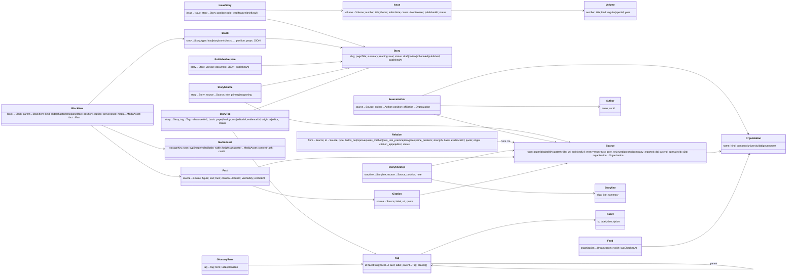

# Data model

Two parts: what exists **today** (JSON files), and the **target** database schema the product plan needs.
The TypeScript types in `src/types.ts` are the contract for today's files.

## Today (JSON files)

| File | Holds |
|---|---|
| `public/data/site.json` | Site name, motto, `mediaBaseUrl`, `defaultPaper`, list of papers `{slug, title, dataUrl}` |
| `public/data/tags.json` | Tag vocabulary: facets, tags `{id: "facet/slug", facet, label, parent, aliases}` |
| `public/data/papers/<slug>.json` | One story: `pageTitle`, `summary`, `issue`, `paper` (source metadata), `tags[]`, `blocks[]`, optional `cover` |
| `public/data/search-index.json` | Generated by `npm run data`: per paper its cover, moments and approved tags |

Blocks: `lead` (slideshow), `story` (chapters), `comic` (strips → panels), `facts` (fact cards). Each media entry is
`{type, src, width, height, alt, poster?}`.

## Target schema

Postgres. JSONB only for layout-specific props; everything we query or reuse gets its own table.
In the diagram, an arrow points from a record to the record it refers to.

### Notes

- **Stub sources:** a `Source` with no `StorySource` row is a greyed "not explained yet" node in the graph.
- **Two dates:** `Source.year` (original publication) vs `Story.publishedAt` / `Issue.publishedAt` (ours).
- **Trust** lives on `Source` (default) and `Fact` (per claim). Company blog numbers are `company_reported`.
- **What the site reads:** `PublishedVersion.document` stores the published story in today's JSON shape, so the
  frontend reads the same document from an API that it reads from files today.
- **Graph queries:** recursive CTEs over `Relation` give ancestors and descendants. A graph database isn't needed
  until much larger scale.
- **Mapping from today:**
  - `papers/<slug>.json` → `Story` + `Block`/`BlockItem` + `StoryTag` + one primary `Source`.
  - `issue` → `IssueStory`.
  - facts → `Fact` + `Citation`.
